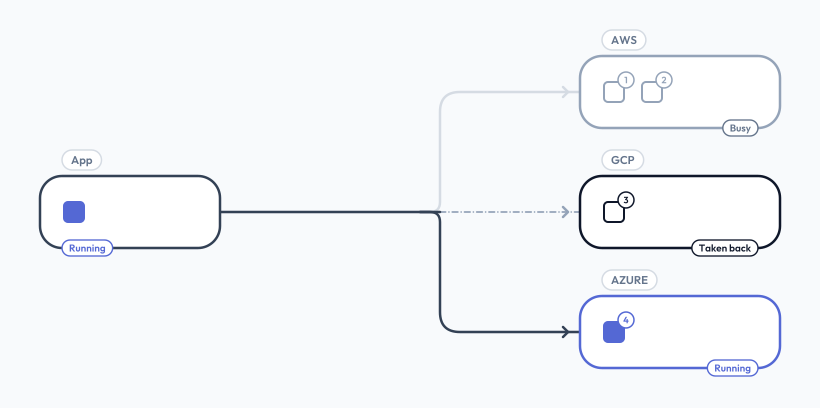

# RIG

**Remote Instance Gateway**

> Create Linux machines on any cloud, and get one even when the cloud has no room

RIG is a TypeScript library, its parts joined by one spec:

- the **core** runs inside your app: it knows your kinds of machines, tries places in order, and keeps watch over what it made;
- a **provider** is a plugin for one cloud, `aws`, `gcp` or `azure`, that makes the machines;
- a **worker**, optional, runs jobs on them: `grid`.



## Why

Creating one machine is easy. Getting one when the zone is full, the type is sold out, or the spot price is too high is not: that is where RIG helps.

- **Failover, not a retry loop.** A kind lists where its machines may go, in order. When a try finds no room, RIG moves on: another zone, another type, `spot` then `demand`, another provider.
- **Spot, with its risk known.** RIG estimates how often each place's spot machines are taken back, from each type's shape and its own counts. It skips places above a kind's limit, warns about risky kinds, and replaces a machine the cloud took back.
- **One recipe, every cloud.** A kind's distro, disk, login, first-boot script and ports mean the same on aws, gcp and azure. Five presets, `small` to `gpu`, give a kind from a name alone.
- **Jobs on the machines.** With a worker, [grid](https://github.com/diphyx/grid), a kind makes short-lived job machines, and the app runs jobs on them: files in, the node's cmds, results back.
- **A library, an open spec.** No server, no CLI, no framework: RIG lives in your app. The contract is written down in [`spec/SPEC.md`](https://github.com/diphyx/rig/blob/HEAD/spec/SPEC.md), and its kit proves it: a core or a provider of your own, in any language, works with the others once it passes.

## How

A **kind** is a named recipe for machines: where to try, in order, and what each machine boots. The [Kind](kind.md) page shows how.

1. The app opens RIG: the core checks the config and every provider, then starts its rounds.
2. The app asks for a machine of a kind: `rig.machine.create("worker")`.
3. The core tries the kind's places in order, one `create` at a time, and stops at the first that has room.
4. The machine boots its distro's newest image, signs in your SSH keys, and runs your script, once.
5. Each round, the core lists its machines: one the cloud took back is **lost**, and the core makes a new one in its place.

The core decides; providers only make what they are asked.


## Where It Sits

RIG sits between a cloud's own SDK and a cluster: more than the SDK (failover, spot risk, recover, one API for three clouds), much lighter than an infrastructure tool or an autoscaler.

|                   | A cloud SDK   | **RIG**                                | Terraform, Pulumi  | A cluster autoscaler |
| ----------------- | ------------- | -------------------------------------- | ------------------ | -------------------- |
| **What it makes** | what you call | machines, by kind, where there is room | what you declare   | a cluster's nodes    |
| **No room**       | an error      | the next place, in order               | an error           | its own retries      |
| **Clouds**        | one           | aws, gcp, azure, yours                 | many, each its own | the cluster's        |
| **Lives in**      | your code     | your app, as a library                 | a plan you apply   | the cluster          |
| **Spot**          | you handle it | its risk estimated, lost replaced      | you handle it      | its own              |
| **Jobs**          | —             | with grid, on job machines             | —                  | pods                 |

In short:

| Good fit                                                                         | Not a fit                                                     |
| -------------------------------------------------------------------------------- | ------------------------------------------------------------- |
| an app that makes machines when it needs them: builds, renders, model runs, labs | infrastructure you declare once and keep: networks, databases |
| spot machines, across zones and clouds, replaced when taken back                 | Windows machines: RIG is Linux only                           |
| short-lived job machines, made per request                                       | services that scale on load: use a cluster for that           |
| one API on aws, gcp and azure                                                    | a cloud's every option: RIG keeps to what all three share     |

## Start

[Get Started](start.md) goes from nothing to a first machine: install, sign in, a kind, open, create, SSH in.

```bash
pnpm add @diphyx/rig @diphyx/rig-aws
```
