# Worker

> Jobs on RIG's machines: RIG makes and replaces them, a worker runs the jobs

A **worker** is a plugin that runs jobs on machines, as a provider is one that makes them: `workers: [grid]`, as `providers: [aws]`. The official one is `@diphyx/rig-grid`, over [grid](https://github.com/diphyx/grid): the app runs grid's **hub**, in TypeScript, and each machine runs grid's own **node**, set up at its first boot.



## 1. Job Machines

A kind with a `worker` makes **job machines**: short-lived, often spot, made to run jobs and replaced at will.

| Kind             | Machines                               | A change                                                       |
| ---------------- | -------------------------------------- | -------------------------------------------------------------- |
| without `worker` | live as long as the app wants them     | the app's own, on its machines                                 |
| with `worker`    | job machines: short-lived, replaceable | a new machine: its `worker`, like its type, is fixed at create |

RIG reaches a job machine twice: its first-boot script, once, then the worker, which runs only what the machine was made for. To change what it runs, change the kind, or give one machine its own at its create: new machines get it, and the old ones end by `life`, `machine.end`, or a take-back.

## 2. Set Up

```bash
pnpm add @diphyx/rig @diphyx/rig-aws @diphyx/rig-grid
```

```ts
import { createRig } from "@diphyx/rig";
import { createAws } from "@diphyx/rig-aws";
import { createGrid } from "@diphyx/rig-grid";

const aws = createAws();

// its IP found, its key made, its grid release built in
const grid = createGrid();

const rig = createRig({
    rig: 1,
    app: "my-app",
    providers: [aws],
    workers: [grid],
    kinds: [
        aws.presets.compute({
            name: "builder",
            life: "8h",
            worker: {
                tags: ["build"],
                cmds: {
                    make: { exec: ["make", "-j8"], timeout: "1h" },
                },
            },
        }),
    ],
});

await rig.open();
await rig.machine.create("builder"); // its node joins the hub once the machine has an IP
```

| `worker` key | Is                                                                                                                  |
| ------------ | ------------------------------------------------------------------------------------------------------------------- |
| `name`       | the worker's `name`; without it, the config's only worker                                                           |
| `tags`       | the kinds of work its machines do: a job runs only on a machine with its tag                                        |
| `cmds`       | grid's: the only cmds its node runs, `exec` and `timeout`; a job adds `args`, `env`                                 |
| `signal`     | grid's: the node also dials the hub, with heartbeats; needs the hub's `listen`                                      |
| `jobs`       | grid's: `limit`, how many at once, `1`; `expires`, how long it keeps a job left idle                                |
| `share`      | grid's: `limit`, how much of its share pushes it keeps, like `"10GB"`; `expires`, how long it keeps one no job uses |

Where the hub runs, the IP its machines trust, its key, ports and release: [grid](grid.md).

## 3. First Boot

At its create, each machine gets its own grid key pair, and these lines, after its `login`:

1. **grid installed:** the release's archive for the machine's arch, checked by its SHA-256.
2. **its user:** a system user, `grid`, that the node runs as.
3. **its keys:** the machine's private key, and the hub's public key, in `/etc/grid`.
4. **`/etc/grid/node.toml`:** its tags, its cmds, its port, and the hub, by IP; with `signal`, the hub's `listen` port too; its `jobs` and `share`, when the kind has them.
5. **a systemd unit,** `grid-node`.
6. **the node started,** after its `script`: no job comes before what the `script` sets up; a failed `script` leaves it off.

It also gets its node's `port`, open to the hub's IP only. RIG's store keeps the public half of the key; the hub trusts it only from that machine's IP.

## 4. Jobs

```ts
const outcome = await grid.run({
    name: "req-42",
    tag: "build",
    push: [{ from: "./src", to: "src" }],
    steps: [{ cmd: "make" }],
    pull: [{ path: "out", into: "./out" }],
    retries: 2,
});
```

| Job key   | Is                                                                                                           |
| --------- | ------------------------------------------------------------------------------------------------------------ |
| `name`    | the app's own name for it, unique among live jobs; by default `job-<8 hex>`                                  |
| `tag`     | which nodes may run it                                                                                       |
| `push`    | `{ from, to?, share? }`: files in, to the job's space by default; a share, kept for later jobs, needs a `to` |
| `steps`   | `{ cmd, args?, env? }`: the node's cmds, in order; the first that fails ends the job                         |
| `pull`    | `{ path, into, fresh?, keep? }`: files back; `fresh`: only what its steps wrote; `keep`: after a kill too    |
| `retries` | how many times a lost node's job starts over elsewhere; `0`                                                  |

`run`'s options: `signal`, an `AbortSignal` that kills it; `watch`, its log lines and events; `next`, more steps after one ends done; `placed`, where it runs, for `grid.recover` after a restart.

## 5. Sessions

For the app's own calls, one at a time:

```ts
const job = await grid.session({ name: "req-42", tag: "build" });

await job.push({ from: "./inputs", to: "." });

// { cmd, state, message }, once the step ends
const step = await job.exec({
    cmd: "make",
    args: ["release"],
    env: { CC: "clang" },
});

await job.pull({ path: "out", into: "./results" });

// done, failed or stopped; the node drops it, its slot is free
const outcome = await job.close();
```

A session waits for a node with room, as a job does, and takes what a job's `push`, `steps` and `pull` take. It has no retries: a lost node fails the call. A kill stops the step it runs; then only `pull`, for what it kept, and `close`.

## 6. Per Request

One kind can make machines for different work: each key of `machine.create`'s `worker` replaces the kind's, for that machine, and its replacement gets the same. `cmds` is replaced whole, not merged; `name` is refused.

```ts
// its own tag, its own cmds
await rig.machine.create("builder", {
    worker: {
        tags: ["req-42"],
        cmds: {
            train: { exec: ["python", "train.py"], timeout: "4h" },
        },
    },
});

await grid.run({ name: "req-42", tag: "req-42", steps: [{ cmd: "train" }] });
```

A machine with its own cmds needs its own tag too, so only its jobs go to it.

## 7. Views

A filter gives those with every key given.

| Call                                         | Gives                                                                                                               |
| -------------------------------------------- | ------------------------------------------------------------------------------------------------------------------- |
| `rig.machine.list({ kind?, status?, tag? })` | RIG's machines; `tag`: a worker's tag                                                                               |
| `grid.jobs({ tag?, state?, node? })`         | the hub's live jobs: `name`, `tag`, `state` (`waiting` or `running`), `node`, `step`, `tries`, `started`, `session` |
| `grid.job(name)`                             | one live job; `null` once it ends                                                                                   |
| `grid.nodes({ tag?, beating?, lost? })`      | its nodes: the machine's `name`, `ip`, `tags`, `beating`, `lost`, and the `jobs` it runs                            |

| Call                        | Does                                                                      |
| --------------------------- | ------------------------------------------------------------------------- |
| `grid.kill(name)`           | stops a live job, or a session; `false` when there is none                |
| `grid.watch(name, handler)` | a live job's log lines and events from now on; gives a call that stops it |
| `grid.on(JobEvent.*, ...)`  | its jobs: `PLACED` on a node, `RETRIED` after a lost one, `ENDED`         |

A node's name is its machine's name, so `rig.machine.list({ tag: "req-42" })`, `grid.nodes({ tag: "req-42" })` and `grid.jobs({ tag: "req-42" })` join on it. The hub keeps its jobs in memory: after a restart, `grid.jobs()` is empty, and `placed` with `grid.recover` take back what ran.

## 8. When a Machine Is Lost

| Who  | Does                                                                                                     |
| ---- | -------------------------------------------------------------------------------------------------------- |
| RIG  | replaces the machine, up to its kind's `recovers`                                                        |
| grid | runs the job again from the start, on any free node with its tag, up to `retries`                        |
| RIG  | when it stops replacing: tells the worker, `spent(tags)`; a job waiting for a tag no node has then fails |

A job keeps its own work: a take-back may come with little warning, or none. Save progress in the job's own steps, and resume from there.

## 9. Your Own

A worker is an object with `slot: "worker"`, a `name`, `rig: 1` and the calls of the spec, §22.1, in the config's `workers`:

| Call    | Does                                                                                          |
| ------- | --------------------------------------------------------------------------------------------- |
| `open`  | optional: what it finds out when RIG opens, before any `setup`, like its own address          |
| `check` | refuses a kind's `worker` whose own keys are not one                                          |
| `setup` | for one machine, at its create: its first-boot lines, the ports it needs, what it knows it by |
| `add`   | takes a machine, by its name, IPs, key and tags                                               |
| `drop`  | forgets a machine                                                                             |
| `spent` | hears that no more machines come for some tags                                                |
